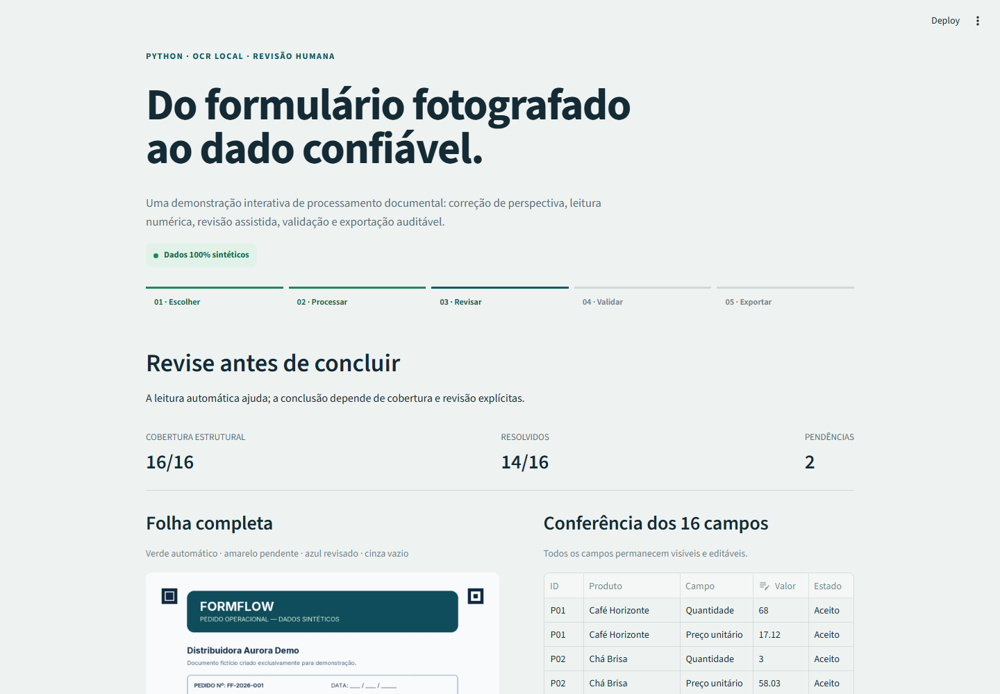

# FormFlow — OCR local com revisão humana


FormFlow é uma demonstração web de processamento inteligente de formulários. A aplicação
transforma uma imagem sintética de pedido em dados estruturados com correção de perspectiva,
OCR numérico local, revisão humana, validação de cobertura e exportação auditável.

O projeto foi criado para demonstrar competências em **Python, automação e dados** de forma
rápida de testar: não exige cadastro, chave de API ou serviço pago.



## O que a demonstração comprova

- processamento real de imagem com OpenCV e quatro marcadores geométricos;
- OCR local com Tesseract, sem enviar documentos para serviços externos;
- 16 campos estruturais sempre representados: quantidade e preço para oito produtos fictícios;
- roteamento conservador: baixa confiança gera pendência, nunca zero ou blank silencioso;
- revisão da folha completa com campos automáticos ainda editáveis;
- validação de pares, faixas numéricas, cobertura e ausência de pendências;
- métricas derivadas do estado final e exportações CSV, XLSX e JSON de auditoria;
- testes automatizados, análise estática e CI em Python 3.11 e 3.12.

## Experimente em três minutos

1. Escolha `Limpo`, `Ruído` ou `Revisão`.
2. Clique em **Processar documento**. O Tesseract executa de verdade no servidor.
3. Confira a folha completa e os 16 campos. Corrija os amarelos, se houver.
4. Conclua apenas quando a cobertura indicar `16/16` e `0 pendências`.
5. Baixe CSV, XLSX ou JSON de auditoria.

Também é possível baixar o template em branco, preencher os campos e enviar uma foto compatível
em JPEG ou PNG. O upload permanece somente na sessão do Streamlit.

## Garantias de integridade

- blank é `None` no domínio e `null` no JSON — nunca é convertido em zero;
- quantidade e preço devem estar ambos preenchidos ou ambos vazios por item;
- falha de OCR, baixa confiança ou marca ambígua permanecem pendentes;
- somente um documento finalizado pode alimentar métricas e exports;
- uma edição humana preserva a origem automática inicial no histórico;
- nenhum upload, valor revisado ou arquivo exportado é persistido.

## Arquitetura

```text
Streamlit UI
    ├── amostras sintéticas / upload limitado
    ├── registro geométrico e extração (OpenCV)
    ├── OCR numérico local (Tesseract)
    ├── roteamento conservador
    ├── revisão humana auditável
    ├── validação 16/16
    └── métricas + CSV / XLSX / JSON
```

As regras de domínio ficam no pacote `formflow`; `app.py` apenas compõe a experiência. Veja
[arquitetura](docs/architecture.md) e [proveniência dos dados](docs/data-provenance.md).

## Execução local

Pré-requisitos: Python 3.11 ou 3.12 e Tesseract OCR 5 disponível no `PATH`. No Windows, o app
também reconhece a instalação padrão em `C:\Program Files\Tesseract-OCR`.

```bash
python -m venv .venv
# Windows: .venv\Scripts\activate
# Linux/macOS: source .venv/bin/activate
python -m pip install -r requirements-dev.txt
python scripts/generate_samples.py
python -m streamlit run app.py
```

## Testes

```bash
python -m ruff check src tests app.py
python -m pytest -v
```

A suíte cobre parsing numérico, template, amostras determinísticas, limites de upload, EXIF,
registro geométrico, OCR, roteamento, revisão, validação, métricas, exports e fluxos Streamlit.

## Limitações conhecidas

- amostras sintéticas não medem desempenho em documentos reais;
- escrita manual muito irregular pode exigir revisão humana;
- somente o template FormFlow com os quatro marcadores é aceito;
- idiomas e campos alfanuméricos não fazem parte desta demonstração.

## Dados e privacidade

Todos os nomes, produtos, números, documentos e imagens são fictícios e foram gerados
exclusivamente para esta demonstração. O projeto não representa o sistema ou os dados de nenhum
cliente. Não há analytics, banco de dados, chamadas OpenAI, Google Sheets ou secrets.

## English summary

FormFlow is a clean-room, fully synthetic portfolio demo for intelligent form processing. It uses
Python, Streamlit, OpenCV and local Tesseract OCR to register a document, extract 16 numeric fields,
route uncertainty to human review, validate full coverage and generate auditable CSV, XLSX and JSON
outputs. No API key, external processing service or persistent storage is required.

## Licença

Código sob a [licença MIT](LICENSE). A fonte Inter incluída nos assets mantém sua própria
[licença SIL Open Font License](assets/fonts/OFL.txt).
