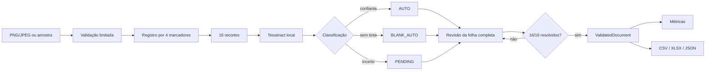

# Arquitetura do FormFlow

## Objetivo

FormFlow separa processamento, decisão e apresentação para que cada garantia relevante seja
testável sem depender da interface. A aplicação processa somente o novo template sintético incluído
no repositório.

## Fluxo

## Camadas

| Módulo | Responsabilidade |
|---|---|
| `domain.py` | tipos imutáveis, chaves, observações e eventos |
| `template.py` | oito produtos fictícios, 16 alvos e quatro marcadores |
| `sample_factory.py` | geração determinística de amostras sintéticas |
| `image_pipeline.py` | limites de upload, EXIF, registro e recortes |
| `ocr.py` | adaptador Tesseract, ocupação de tinta e classificação |
| `review.py` | única fronteira mutável da revisão e histórico humano |
| `validation.py` | cobertura, pendências, faixas e pares completos |
| `metrics.py` | indicadores derivados somente do documento finalizado |
| `exporters.py` | geração em memória de CSV, XLSX e JSON |
| `app_state.py` | progressão explícita da sessão Streamlit |
| `ui.py` / `app.py` | apresentação e composição do fluxo |

## Decisões de integridade

### Representação completa

As 16 chaves esperadas são definidas uma vez em `FIELD_LAYOUT`. Cada recorte produz uma observação
`AUTO`, `BLANK` ou `PENDING`; falhas não removem campos do resultado.

### Incerteza conservadora

Confiança de OCR e ocupação de tinta usam limites próprios desta demonstração. Texto não vazio com
baixa confiança, falha de parsing ou tinta ambígua resulta em `PENDING`.

### Estado final imutável

`ReviewSession` é a única fronteira de alteração. Finalização cria um `ValidatedDocument` imutável;
métricas e exports recusam sessões mutáveis.

### Processamento efêmero

Imagem, revisão e resultado vivem em `st.session_state`. Upload e exports não são gravados no
filesystem, banco ou serviço externo.

## Contrato de entrada

- JPEG ou PNG identificado pelo conteúdo, não pelo nome;
- máximo de 10 MB e 20 megapixels;
- somente um frame;
- orientação EXIF normalizada;
- quatro marcadores FormFlow únicos;
- quantidade inteira entre 0 e 999;
- preço entre 0,00 e 9.999,99, sem separador de milhares.

## Testabilidade

O protocolo `OcrEngine` permite testes determinísticos, enquanto a integração executa Tesseract
real sobre a amostra sintética. AppTest verifica progressão, bloqueios e downloads; a CI instala
Tesseract e executa a suíte completa em Python 3.11 e 3.12.
